# Abstract site conditions

Source: [`site-conditions.skos.ttl`](sources/site-condition.ttl)

## Scheme

- **definition (de):** Hierarchische Klassifikation der Bedingungen, die ein Standort einem Projekt setzt: rechtliche Vorgaben, Erschliessung, Werkanschlüsse, Entwurfsabsichten, Bestand und Bauablauf. Klassifiziert Geometrie aus Situationsplänen (Punkte, Linien, Flächen) und Standortfakten nach ihrer Bedeutung.
- **definition (en):** Hierarchical classification of the conditions a site sets for a project: legal limits, access, utility connections, design intent, existing conditions, and construction. Classifies site plan geometry (points, lines, areas) and site facts by what they are.
- **prefLabel (de):** Abstrakte Standortbedingungen
- **prefLabel (en):** Abstract site conditions
- **title (en):** Abstract site conditions

## Hierarchy

```mermaid
classDiagram
direction TB
class n_SC_ACC["SC-ACC: Access"]
class n_SC_ACC_BIKE["SC-ACC-BIKE: Bicycle access"]
class n_SC_ACC_CAR["SC-ACC-CAR: Car access"]
class n_SC_ACC_DELIVERY["SC-ACC-DELIVERY: Delivery access"]
class n_SC_ACC_PEDESTRIAN["SC-ACC-PEDESTRIAN: Pedestrian access"]
class n_SC_CON["SC-CON: Construction condition"]
class n_SC_CON_ACCESS["SC-CON-ACCESS: Construction access"]
class n_SC_CON_LOGISTICS["SC-CON-LOGISTICS: Construction logistics area"]
class n_SC_DES["SC-DES: Design intent"]
class n_SC_DES_OPEN_SPACE["SC-DES-OPEN-SPACE: Preferred open space"]
class n_SC_DES_OPEN_SPACE_GREEN["SC-DES-OPEN-SPACE-GREEN: Green open space"]
class n_SC_DES_OPEN_SPACE_PAVED["SC-DES-OPEN-SPACE-PAVED: Paved open space"]
class n_SC_DES_SENSITIVE_EDGE["SC-DES-SENSITIVE-EDGE: Sensitive edge"]
class n_SC_DES_SIGHTLINE["SC-DES-SIGHTLINE: Sightline"]
class n_SC_EXI["SC-EXI: Existing condition"]
class n_SC_EXI_BUILDING["SC-EXI-BUILDING: Existing building"]
class n_SC_EXI_BUILDING_DEMOLISH["SC-EXI-BUILDING-DEMOLISH: Building to demolish"]
class n_SC_EXI_BUILDING_KEEP["SC-EXI-BUILDING-KEEP: Building to keep"]
class n_SC_EXI_TERRAIN["SC-EXI-TERRAIN: Existing terrain"]
class n_SC_EXI_TREE["SC-EXI-TREE: Existing tree"]
class n_SC_EXI_TREE_FELL["SC-EXI-TREE-FELL: Tree to fell"]
class n_SC_EXI_TREE_KEEP["SC-EXI-TREE-KEEP: Tree to keep"]
class n_SC_EXI_UTILITY["SC-EXI-UTILITY: Existing utility line"]
class n_SC_LEG["SC-LEG: Legal limit"]
class n_SC_LEG_BUILDING_LINE["SC-LEG-BUILDING-LINE: Building line"]
class n_SC_LEG_EASEMENT["SC-LEG-EASEMENT: Easement"]
class n_SC_LEG_EASEMENT_RESTRICTION["SC-LEG-EASEMENT-RESTRICTION: Building restriction"]
class n_SC_LEG_EASEMENT_ROW["SC-LEG-EASEMENT-ROW: Right of way"]
class n_SC_LEG_EASEMENT_UTILITY["SC-LEG-EASEMENT-UTILITY: Utility line right"]
class n_SC_LEG_HERITAGE["SC-LEG-HERITAGE: Heritage protection"]
class n_SC_LEG_PARCEL["SC-LEG-PARCEL: Parcel boundary"]
class n_SC_LEG_SETBACK["SC-LEG-SETBACK: Setback line"]
class n_SC_LEG_SETBACK_BOUNDARY["SC-LEG-SETBACK-BOUNDARY: Boundary setback"]
class n_SC_LEG_SETBACK_FOREST["SC-LEG-SETBACK-FOREST: Forest setback"]
class n_SC_LEG_SETBACK_WATER["SC-LEG-SETBACK-WATER: Watercourse setback"]
class n_SC_LEG_ZONE["SC-LEG-ZONE: Land-use zone"]
class n_SC_UTL["SC-UTL: Utility connection"]
class n_SC_UTL_ELECTRICITY["SC-UTL-ELECTRICITY: Electricity connection"]
class n_SC_UTL_GAS["SC-UTL-GAS: Gas connection"]
class n_SC_UTL_STORMWATER["SC-UTL-STORMWATER: Stormwater discharge"]
class n_SC_UTL_TELECOM["SC-UTL-TELECOM: Telecom connection"]
class n_SC_UTL_THERMAL["SC-UTL-THERMAL: Thermal network connection"]
class n_SC_UTL_WASTEWATER["SC-UTL-WASTEWATER: Wastewater connection"]
class n_SC_UTL_WATER["SC-UTL-WATER: Water supply connection"]
n_SC_ACC <|-- n_SC_ACC_BIKE
n_SC_ACC <|-- n_SC_ACC_CAR
n_SC_ACC <|-- n_SC_ACC_DELIVERY
n_SC_ACC <|-- n_SC_ACC_PEDESTRIAN
n_SC_CON <|-- n_SC_CON_ACCESS
n_SC_CON <|-- n_SC_CON_LOGISTICS
n_SC_DES <|-- n_SC_DES_OPEN_SPACE
n_SC_DES <|-- n_SC_DES_SENSITIVE_EDGE
n_SC_DES <|-- n_SC_DES_SIGHTLINE
n_SC_DES_OPEN_SPACE <|-- n_SC_DES_OPEN_SPACE_GREEN
n_SC_DES_OPEN_SPACE <|-- n_SC_DES_OPEN_SPACE_PAVED
n_SC_EXI <|-- n_SC_EXI_BUILDING
n_SC_EXI <|-- n_SC_EXI_TERRAIN
n_SC_EXI <|-- n_SC_EXI_TREE
n_SC_EXI <|-- n_SC_EXI_UTILITY
n_SC_EXI_BUILDING <|-- n_SC_EXI_BUILDING_DEMOLISH
n_SC_EXI_BUILDING <|-- n_SC_EXI_BUILDING_KEEP
n_SC_EXI_TREE <|-- n_SC_EXI_TREE_FELL
n_SC_EXI_TREE <|-- n_SC_EXI_TREE_KEEP
n_SC_LEG <|-- n_SC_LEG_BUILDING_LINE
n_SC_LEG <|-- n_SC_LEG_EASEMENT
n_SC_LEG <|-- n_SC_LEG_HERITAGE
n_SC_LEG <|-- n_SC_LEG_PARCEL
n_SC_LEG <|-- n_SC_LEG_SETBACK
n_SC_LEG <|-- n_SC_LEG_ZONE
n_SC_LEG_EASEMENT <|-- n_SC_LEG_EASEMENT_RESTRICTION
n_SC_LEG_EASEMENT <|-- n_SC_LEG_EASEMENT_ROW
n_SC_LEG_EASEMENT <|-- n_SC_LEG_EASEMENT_UTILITY
n_SC_LEG_SETBACK <|-- n_SC_LEG_SETBACK_BOUNDARY
n_SC_LEG_SETBACK <|-- n_SC_LEG_SETBACK_FOREST
n_SC_LEG_SETBACK <|-- n_SC_LEG_SETBACK_WATER
n_SC_UTL <|-- n_SC_UTL_ELECTRICITY
n_SC_UTL <|-- n_SC_UTL_GAS
n_SC_UTL <|-- n_SC_UTL_STORMWATER
n_SC_UTL <|-- n_SC_UTL_TELECOM
n_SC_UTL <|-- n_SC_UTL_THERMAL
n_SC_UTL <|-- n_SC_UTL_WASTEWATER
n_SC_UTL <|-- n_SC_UTL_WATER
```

## Concepts

<button type="button" class="pbs-lang-btn" data-lang="de">DE</button>
<button type="button" class="pbs-lang-btn" data-lang="en">EN</button>

<table>
<thead>
<tr>
<th>Notation</th>
<th>Broader</th>
<th class="pbs-lang-col" data-lang="de" data-field="label">Label</th>
<th class="pbs-lang-col" data-lang="de" data-field="definition">Definition</th>
<th class="pbs-lang-col" data-lang="de" data-field="description">Description</th>
<th class="pbs-lang-col" data-lang="de" data-field="scope_note">Scope note</th>
<th class="pbs-lang-col" data-lang="en" data-field="label">Label</th>
<th class="pbs-lang-col" data-lang="en" data-field="definition">Definition</th>
<th class="pbs-lang-col" data-lang="en" data-field="description">Description</th>
<th class="pbs-lang-col" data-lang="en" data-field="scope_note">Scope note</th>
</tr>
</thead>
<tbody>
<tr>
<td>SC-ACC</td>
<td></td>
<td class="pbs-lang-col" data-lang="de" data-field="label">Erschliessung</td>
<td class="pbs-lang-col" data-lang="de" data-field="definition">Wo Personen und Fahrzeuge das Grundstück im Betrieb erreichen.</td>
<td class="pbs-lang-col" data-lang="de" data-field="description">Punkt oder Linie mit Richtung, vom öffentlichen Netz auf das Grundstück.</td>
<td class="pbs-lang-col" data-lang="de" data-field="scope_note">Dauerhafte Erschliessung. Temporäre Zufahrt für den Bauverkehr ist SC-CON-ACCESS.</td>
<td class="pbs-lang-col" data-lang="en" data-field="label">Access</td>
<td class="pbs-lang-col" data-lang="en" data-field="definition">Where people and vehicles reach the site in operation.</td>
<td class="pbs-lang-col" data-lang="en" data-field="description">Point or line with direction, from the public network onto the site.</td>
<td class="pbs-lang-col" data-lang="en" data-field="scope_note">Permanent access. Temporary access for construction traffic is SC-CON-ACCESS.</td>
</tr>
<tr>
<td>SC-ACC-BIKE</td>
<td>SC-ACC</td>
<td class="pbs-lang-col" data-lang="de" data-field="label">Zufahrt Velo</td>
<td class="pbs-lang-col" data-lang="de" data-field="definition">Zufahrt für Velos.</td>
<td class="pbs-lang-col" data-lang="de" data-field="description"></td>
<td class="pbs-lang-col" data-lang="de" data-field="scope_note"></td>
<td class="pbs-lang-col" data-lang="en" data-field="label">Bicycle access</td>
<td class="pbs-lang-col" data-lang="en" data-field="definition">Access for bicycles.</td>
<td class="pbs-lang-col" data-lang="en" data-field="description"></td>
<td class="pbs-lang-col" data-lang="en" data-field="scope_note"></td>
</tr>
<tr>
<td>SC-ACC-CAR</td>
<td>SC-ACC</td>
<td class="pbs-lang-col" data-lang="de" data-field="label">Zufahrt Personenwagen</td>
<td class="pbs-lang-col" data-lang="de" data-field="definition">Zufahrt für Personenwagen, einschliesslich der Einfahrt in eine Einstellhalle.</td>
<td class="pbs-lang-col" data-lang="de" data-field="description"></td>
<td class="pbs-lang-col" data-lang="de" data-field="scope_note"></td>
<td class="pbs-lang-col" data-lang="en" data-field="label">Car access</td>
<td class="pbs-lang-col" data-lang="en" data-field="definition">Access for passenger cars, including the entrance to a car park.</td>
<td class="pbs-lang-col" data-lang="en" data-field="description"></td>
<td class="pbs-lang-col" data-lang="en" data-field="scope_note"></td>
</tr>
<tr>
<td>SC-ACC-DELIVERY</td>
<td>SC-ACC</td>
<td class="pbs-lang-col" data-lang="de" data-field="label">Anlieferung</td>
<td class="pbs-lang-col" data-lang="de" data-field="definition">Zufahrt für Lastwagen und Lieferwagen im Betrieb.</td>
<td class="pbs-lang-col" data-lang="de" data-field="description"></td>
<td class="pbs-lang-col" data-lang="de" data-field="scope_note">Anlieferung im Betrieb. Anlieferung während des Baus ist SC-CON-ACCESS.</td>
<td class="pbs-lang-col" data-lang="en" data-field="label">Delivery access</td>
<td class="pbs-lang-col" data-lang="en" data-field="definition">Access for delivery trucks and vans in operation.</td>
<td class="pbs-lang-col" data-lang="en" data-field="description"></td>
<td class="pbs-lang-col" data-lang="en" data-field="scope_note">Deliveries in operation. Construction deliveries are SC-CON-ACCESS.</td>
</tr>
<tr>
<td>SC-ACC-PEDESTRIAN</td>
<td>SC-ACC</td>
<td class="pbs-lang-col" data-lang="de" data-field="label">Zugang Fussgänger</td>
<td class="pbs-lang-col" data-lang="de" data-field="definition">Zugang zu Fuss, einschliesslich des Hauptzugangs.</td>
<td class="pbs-lang-col" data-lang="de" data-field="description"></td>
<td class="pbs-lang-col" data-lang="de" data-field="scope_note"></td>
<td class="pbs-lang-col" data-lang="en" data-field="label">Pedestrian access</td>
<td class="pbs-lang-col" data-lang="en" data-field="definition">Access on foot, including the main entrance route.</td>
<td class="pbs-lang-col" data-lang="en" data-field="description"></td>
<td class="pbs-lang-col" data-lang="en" data-field="scope_note"></td>
</tr>
<tr>
<td>SC-CON</td>
<td></td>
<td class="pbs-lang-col" data-lang="de" data-field="label">Bauablauf</td>
<td class="pbs-lang-col" data-lang="de" data-field="definition">Bedingung für die Bauphase, die die Bestellung festlegt, bevor die Baustelleneinrichtung geplant ist.</td>
<td class="pbs-lang-col" data-lang="de" data-field="description"></td>
<td class="pbs-lang-col" data-lang="de" data-field="scope_note">Planungszonen auf Stufe Bestellung. Die darin platzierten Einrichtungen (Tor, Baupiste, Lager, Container) sind Baustelleneinrichtungsprodukte (SFP).</td>
<td class="pbs-lang-col" data-lang="en" data-field="label">Construction condition</td>
<td class="pbs-lang-col" data-lang="en" data-field="definition">Condition for the construction phase that the brief fixes before site facilities are planned.</td>
<td class="pbs-lang-col" data-lang="en" data-field="description"></td>
<td class="pbs-lang-col" data-lang="en" data-field="scope_note">Planning zones at brief stage. The facilities placed in them (gate, haul road, storage, containers) are site facility products (SFP).</td>
</tr>
<tr>
<td>SC-CON-ACCESS</td>
<td>SC-CON</td>
<td class="pbs-lang-col" data-lang="de" data-field="label">Baustellenzufahrt</td>
<td class="pbs-lang-col" data-lang="de" data-field="definition">Weg, auf dem der Bauverkehr das Grundstück vom öffentlichen Strassennetz erreicht.</td>
<td class="pbs-lang-col" data-lang="de" data-field="description">Linie mit Richtung. Die Fahrzeugklasse (Lastwagen, Lieferwagen, Fussgänger) wird am Eintrag erfasst.</td>
<td class="pbs-lang-col" data-lang="de" data-field="scope_note">Temporär. Dauerhafte Erschliessung ist SC-ACC.</td>
<td class="pbs-lang-col" data-lang="en" data-field="label">Construction access</td>
<td class="pbs-lang-col" data-lang="en" data-field="definition">Route by which construction traffic reaches the site from the public road network.</td>
<td class="pbs-lang-col" data-lang="en" data-field="description">Line with direction. The vehicle class (truck, van, pedestrian) is recorded on the item.</td>
<td class="pbs-lang-col" data-lang="en" data-field="scope_note">Temporary. Permanent access is SC-ACC.</td>
</tr>
<tr>
<td>SC-CON-LOGISTICS</td>
<td>SC-CON</td>
<td class="pbs-lang-col" data-lang="de" data-field="label">Baustelleninstallationsfläche</td>
<td class="pbs-lang-col" data-lang="de" data-field="definition">Teil des Grundstücks oder angrenzender Flächen, der während des Baus für Baustelleneinrichtung, Lager und Umschlag reserviert ist.</td>
<td class="pbs-lang-col" data-lang="de" data-field="description">Fläche.</td>
<td class="pbs-lang-col" data-lang="de" data-field="scope_note"></td>
<td class="pbs-lang-col" data-lang="en" data-field="label">Construction logistics area</td>
<td class="pbs-lang-col" data-lang="en" data-field="definition">Part of the site or adjoining land reserved for site facilities, storage, and handling during construction.</td>
<td class="pbs-lang-col" data-lang="en" data-field="description">Area.</td>
<td class="pbs-lang-col" data-lang="en" data-field="scope_note"></td>
</tr>
<tr>
<td>SC-DES</td>
<td></td>
<td class="pbs-lang-col" data-lang="de" data-field="label">Entwurfsabsicht</td>
<td class="pbs-lang-col" data-lang="de" data-field="definition">Räumliche Absicht für das Grundstück, die den Entwurf ohne rechtliche Grundlage lenkt.</td>
<td class="pbs-lang-col" data-lang="de" data-field="description"></td>
<td class="pbs-lang-col" data-lang="de" data-field="scope_note"></td>
<td class="pbs-lang-col" data-lang="en" data-field="label">Design intent</td>
<td class="pbs-lang-col" data-lang="en" data-field="definition">Spatial intent for the site that guides the design without a legal basis.</td>
<td class="pbs-lang-col" data-lang="en" data-field="description"></td>
<td class="pbs-lang-col" data-lang="en" data-field="scope_note"></td>
</tr>
<tr>
<td>SC-DES-OPEN-SPACE</td>
<td>SC-DES</td>
<td class="pbs-lang-col" data-lang="de" data-field="label">Bevorzugter Freiraum</td>
<td class="pbs-lang-col" data-lang="de" data-field="definition">Teil des Grundstücks, der frei von Bauten bleiben soll.</td>
<td class="pbs-lang-col" data-lang="de" data-field="description">Fläche.</td>
<td class="pbs-lang-col" data-lang="de" data-field="scope_note">Absicht für die Fläche. Der Belag wird mit Aussenbodenbelägen (AOF) klassifiziert, die Raumnutzung mit Raumnamen (RN-OUT-*).</td>
<td class="pbs-lang-col" data-lang="en" data-field="label">Preferred open space</td>
<td class="pbs-lang-col" data-lang="en" data-field="definition">Part of the site that should stay free of buildings.</td>
<td class="pbs-lang-col" data-lang="en" data-field="description">Area.</td>
<td class="pbs-lang-col" data-lang="en" data-field="scope_note">Intent for the area. The surface finish is classified with outdoor floor surfaces (AOF), the space use with room names (RN-OUT-*).</td>
</tr>
<tr>
<td>SC-DES-OPEN-SPACE-GREEN</td>
<td>SC-DES-OPEN-SPACE</td>
<td class="pbs-lang-col" data-lang="de" data-field="label">Grüner Freiraum</td>
<td class="pbs-lang-col" data-lang="de" data-field="definition">Freiraum, der bepflanzt werden soll.</td>
<td class="pbs-lang-col" data-lang="de" data-field="description"></td>
<td class="pbs-lang-col" data-lang="de" data-field="scope_note"></td>
<td class="pbs-lang-col" data-lang="en" data-field="label">Green open space</td>
<td class="pbs-lang-col" data-lang="en" data-field="definition">Open space intended to be planted.</td>
<td class="pbs-lang-col" data-lang="en" data-field="description"></td>
<td class="pbs-lang-col" data-lang="en" data-field="scope_note"></td>
</tr>
<tr>
<td>SC-DES-OPEN-SPACE-PAVED</td>
<td>SC-DES-OPEN-SPACE</td>
<td class="pbs-lang-col" data-lang="de" data-field="label">Befestigter Freiraum</td>
<td class="pbs-lang-col" data-lang="de" data-field="definition">Freiraum, der befestigt werden soll, wie ein Platz oder Vorplatz.</td>
<td class="pbs-lang-col" data-lang="de" data-field="description"></td>
<td class="pbs-lang-col" data-lang="de" data-field="scope_note"></td>
<td class="pbs-lang-col" data-lang="en" data-field="label">Paved open space</td>
<td class="pbs-lang-col" data-lang="en" data-field="definition">Open space intended to be paved, such as a square or forecourt.</td>
<td class="pbs-lang-col" data-lang="en" data-field="description"></td>
<td class="pbs-lang-col" data-lang="en" data-field="scope_note"></td>
</tr>
<tr>
<td>SC-DES-SENSITIVE-EDGE</td>
<td>SC-DES</td>
<td class="pbs-lang-col" data-lang="de" data-field="label">Sensibler Rand</td>
<td class="pbs-lang-col" data-lang="de" data-field="definition">Rand des Grundstücks, an dem der Entwurf auf die Nachbarschaft reagieren muss, zum Beispiel mit geringerer Höhe, weniger Öffnungen oder einem Puffer.</td>
<td class="pbs-lang-col" data-lang="de" data-field="description">Linie entlang oder nahe der Parzellengrenze.</td>
<td class="pbs-lang-col" data-lang="de" data-field="scope_note"></td>
<td class="pbs-lang-col" data-lang="en" data-field="label">Sensitive edge</td>
<td class="pbs-lang-col" data-lang="en" data-field="definition">Edge of the site where the design must respond to neighbours, for example with lower height, fewer openings, or a buffer.</td>
<td class="pbs-lang-col" data-lang="en" data-field="description">Line along or near the parcel boundary.</td>
<td class="pbs-lang-col" data-lang="en" data-field="scope_note"></td>
</tr>
<tr>
<td>SC-DES-SIGHTLINE</td>
<td>SC-DES</td>
<td class="pbs-lang-col" data-lang="de" data-field="label">Sichtbezug</td>
<td class="pbs-lang-col" data-lang="de" data-field="definition">Sicht zum oder vom Grundstück, die der Entwurf freihalten soll.</td>
<td class="pbs-lang-col" data-lang="de" data-field="description">Linie vom Standpunkt in Blickrichtung.</td>
<td class="pbs-lang-col" data-lang="de" data-field="scope_note"></td>
<td class="pbs-lang-col" data-lang="en" data-field="label">Sightline</td>
<td class="pbs-lang-col" data-lang="en" data-field="definition">View to or from the site that the design should keep open.</td>
<td class="pbs-lang-col" data-lang="en" data-field="description">Line from the viewpoint in the direction of view.</td>
<td class="pbs-lang-col" data-lang="en" data-field="scope_note"></td>
</tr>
<tr>
<td>SC-EXI</td>
<td></td>
<td class="pbs-lang-col" data-lang="de" data-field="label">Bestand</td>
<td class="pbs-lang-col" data-lang="de" data-field="definition">Physisches Element auf oder unter dem Grundstück vor Projektbeginn.</td>
<td class="pbs-lang-col" data-lang="de" data-field="description"></td>
<td class="pbs-lang-col" data-lang="de" data-field="scope_note"></td>
<td class="pbs-lang-col" data-lang="en" data-field="label">Existing condition</td>
<td class="pbs-lang-col" data-lang="en" data-field="definition">Physical feature on or below the site before the project starts.</td>
<td class="pbs-lang-col" data-lang="en" data-field="description"></td>
<td class="pbs-lang-col" data-lang="en" data-field="scope_note"></td>
</tr>
<tr>
<td>SC-EXI-BUILDING</td>
<td>SC-EXI</td>
<td class="pbs-lang-col" data-lang="de" data-field="label">Bestandsgebäude</td>
<td class="pbs-lang-col" data-lang="de" data-field="definition">Gebäude oder Bauwerk, das auf dem Grundstück steht.</td>
<td class="pbs-lang-col" data-lang="de" data-field="description">Grundrissfläche; Höhe oder Geschosse am Eintrag. Die Elternklasse zuweisen, solange Erhalt oder Abbruch offen ist.</td>
<td class="pbs-lang-col" data-lang="de" data-field="scope_note"></td>
<td class="pbs-lang-col" data-lang="en" data-field="label">Existing building</td>
<td class="pbs-lang-col" data-lang="en" data-field="definition">Building or structure that stands on the site.</td>
<td class="pbs-lang-col" data-lang="en" data-field="description">Footprint area; height or storeys on the item. Assign the parent while keeping or demolishing is undecided.</td>
<td class="pbs-lang-col" data-lang="en" data-field="scope_note"></td>
</tr>
<tr>
<td>SC-EXI-BUILDING-DEMOLISH</td>
<td>SC-EXI-BUILDING</td>
<td class="pbs-lang-col" data-lang="de" data-field="label">Gebäude abbrechen</td>
<td class="pbs-lang-col" data-lang="de" data-field="definition">Bestandsgebäude, das für das Projekt rückgebaut wird.</td>
<td class="pbs-lang-col" data-lang="de" data-field="description"></td>
<td class="pbs-lang-col" data-lang="de" data-field="scope_note"></td>
<td class="pbs-lang-col" data-lang="en" data-field="label">Building to demolish</td>
<td class="pbs-lang-col" data-lang="en" data-field="definition">Existing building that is removed for the project.</td>
<td class="pbs-lang-col" data-lang="en" data-field="description"></td>
<td class="pbs-lang-col" data-lang="en" data-field="scope_note"></td>
</tr>
<tr>
<td>SC-EXI-BUILDING-KEEP</td>
<td>SC-EXI-BUILDING</td>
<td class="pbs-lang-col" data-lang="de" data-field="label">Gebäude erhalten</td>
<td class="pbs-lang-col" data-lang="de" data-field="definition">Bestandsgebäude, das bestehen bleibt.</td>
<td class="pbs-lang-col" data-lang="de" data-field="description"></td>
<td class="pbs-lang-col" data-lang="de" data-field="scope_note"></td>
<td class="pbs-lang-col" data-lang="en" data-field="label">Building to keep</td>
<td class="pbs-lang-col" data-lang="en" data-field="definition">Existing building that stays.</td>
<td class="pbs-lang-col" data-lang="en" data-field="description"></td>
<td class="pbs-lang-col" data-lang="en" data-field="scope_note"></td>
</tr>
<tr>
<td>SC-EXI-TERRAIN</td>
<td>SC-EXI</td>
<td class="pbs-lang-col" data-lang="de" data-field="label">Bestehendes Terrain</td>
<td class="pbs-lang-col" data-lang="de" data-field="definition">Aufgenommene Geländehöhen des Grundstücks, als Höhenkurven oder Höhenkoten.</td>
<td class="pbs-lang-col" data-lang="de" data-field="description"></td>
<td class="pbs-lang-col" data-lang="de" data-field="scope_note"></td>
<td class="pbs-lang-col" data-lang="en" data-field="label">Existing terrain</td>
<td class="pbs-lang-col" data-lang="en" data-field="definition">Surveyed ground levels of the site, as contour lines or spot heights.</td>
<td class="pbs-lang-col" data-lang="en" data-field="description"></td>
<td class="pbs-lang-col" data-lang="en" data-field="scope_note"></td>
</tr>
<tr>
<td>SC-EXI-TREE</td>
<td>SC-EXI</td>
<td class="pbs-lang-col" data-lang="de" data-field="label">Bestandsbaum</td>
<td class="pbs-lang-col" data-lang="de" data-field="definition">Baum, der auf dem Grundstück steht oder in es hineinragt.</td>
<td class="pbs-lang-col" data-lang="de" data-field="description">Punkt am Stamm; Kronendurchmesser und Art am Eintrag. Die Elternklasse zuweisen, solange Erhalt oder Fällung offen ist.</td>
<td class="pbs-lang-col" data-lang="de" data-field="scope_note"></td>
<td class="pbs-lang-col" data-lang="en" data-field="label">Existing tree</td>
<td class="pbs-lang-col" data-lang="en" data-field="definition">Tree that stands on the site or overhangs it.</td>
<td class="pbs-lang-col" data-lang="en" data-field="description">Point at the trunk; crown diameter and species on the item. Assign the parent while keeping or felling is undecided.</td>
<td class="pbs-lang-col" data-lang="en" data-field="scope_note"></td>
</tr>
<tr>
<td>SC-EXI-TREE-FELL</td>
<td>SC-EXI-TREE</td>
<td class="pbs-lang-col" data-lang="de" data-field="label">Baum fällen</td>
<td class="pbs-lang-col" data-lang="de" data-field="definition">Bestandsbaum, der für das Projekt entfernt wird.</td>
<td class="pbs-lang-col" data-lang="de" data-field="description"></td>
<td class="pbs-lang-col" data-lang="de" data-field="scope_note"></td>
<td class="pbs-lang-col" data-lang="en" data-field="label">Tree to fell</td>
<td class="pbs-lang-col" data-lang="en" data-field="definition">Existing tree that is removed for the project.</td>
<td class="pbs-lang-col" data-lang="en" data-field="description"></td>
<td class="pbs-lang-col" data-lang="en" data-field="scope_note"></td>
</tr>
<tr>
<td>SC-EXI-TREE-KEEP</td>
<td>SC-EXI-TREE</td>
<td class="pbs-lang-col" data-lang="de" data-field="label">Baum erhalten</td>
<td class="pbs-lang-col" data-lang="de" data-field="definition">Bestandsbaum, der bestehen bleibt und während des Baus geschützt wird.</td>
<td class="pbs-lang-col" data-lang="de" data-field="description"></td>
<td class="pbs-lang-col" data-lang="de" data-field="scope_note"></td>
<td class="pbs-lang-col" data-lang="en" data-field="label">Tree to keep</td>
<td class="pbs-lang-col" data-lang="en" data-field="definition">Existing tree that stays and is protected during construction.</td>
<td class="pbs-lang-col" data-lang="en" data-field="description"></td>
<td class="pbs-lang-col" data-lang="en" data-field="scope_note"></td>
</tr>
<tr>
<td>SC-EXI-UTILITY</td>
<td>SC-EXI</td>
<td class="pbs-lang-col" data-lang="de" data-field="label">Bestehende Werkleitung</td>
<td class="pbs-lang-col" data-lang="de" data-field="definition">Leitung im oder durch das Grundstück, wie Wasser, Abwasser, Gas, Strom oder Telekommunikation.</td>
<td class="pbs-lang-col" data-lang="de" data-field="description">Linie; Medium und Tiefe am Eintrag.</td>
<td class="pbs-lang-col" data-lang="de" data-field="scope_note">Die physische Leitung. Das Recht, sie zu führen, ist SC-LEG-EASEMENT-UTILITY; der Punkt, an dem das Grundstück ans Netz angeschlossen wird, ist SC-UTL.</td>
<td class="pbs-lang-col" data-lang="en" data-field="label">Existing utility line</td>
<td class="pbs-lang-col" data-lang="en" data-field="definition">Pipe or cable in or across the site, such as water, sewage, gas, power, or telecom.</td>
<td class="pbs-lang-col" data-lang="en" data-field="description">Line; medium and depth on the item.</td>
<td class="pbs-lang-col" data-lang="en" data-field="scope_note">The physical line. The right to run it is SC-LEG-EASEMENT-UTILITY; the point where the site connects to the network is SC-UTL.</td>
</tr>
<tr>
<td>SC-LEG</td>
<td></td>
<td class="pbs-lang-col" data-lang="de" data-field="label">Rechtliche Vorgabe</td>
<td class="pbs-lang-col" data-lang="de" data-field="definition">Beschränkung, wo und wie auf dem Grundstück gebaut werden darf, aus Grundeigentum, Planungsrecht oder privaten Rechten.</td>
<td class="pbs-lang-col" data-lang="de" data-field="description"></td>
<td class="pbs-lang-col" data-lang="de" data-field="scope_note"></td>
<td class="pbs-lang-col" data-lang="en" data-field="label">Legal limit</td>
<td class="pbs-lang-col" data-lang="en" data-field="definition">Limit on where and how the site may be built on, set by land law, planning law, or private rights.</td>
<td class="pbs-lang-col" data-lang="en" data-field="description"></td>
<td class="pbs-lang-col" data-lang="en" data-field="scope_note"></td>
</tr>
<tr>
<td>SC-LEG-BUILDING-LINE</td>
<td>SC-LEG</td>
<td class="pbs-lang-col" data-lang="de" data-field="label">Baulinie</td>
<td class="pbs-lang-col" data-lang="de" data-field="definition">In einem Plan festgelegte Linie, die Bauten nicht überschreiten dürfen, typischerweise entlang von Strassen, Bahnen oder Gewässern.</td>
<td class="pbs-lang-col" data-lang="de" data-field="description">Linie. Durch einen genehmigten Plan festgelegt, unabhängig von der Parzellengrenze.</td>
<td class="pbs-lang-col" data-lang="de" data-field="scope_note">Eine in einem Plan eingetragene Linie. Ein Mindestabstand ab Parzellengrenze, Wald oder Gewässer ist SC-LEG-SETBACK.</td>
<td class="pbs-lang-col" data-lang="en" data-field="label">Building line</td>
<td class="pbs-lang-col" data-lang="en" data-field="definition">Line fixed in a plan that buildings may not cross, typically along roads, railways, or watercourses.</td>
<td class="pbs-lang-col" data-lang="en" data-field="description">Line. Set by an approved plan, independent of the parcel boundary.</td>
<td class="pbs-lang-col" data-lang="en" data-field="scope_note">A plotted line from a plan. A minimum distance measured from the parcel boundary, a forest, or a watercourse is SC-LEG-SETBACK.</td>
</tr>
<tr>
<td>SC-LEG-EASEMENT</td>
<td>SC-LEG</td>
<td class="pbs-lang-col" data-lang="de" data-field="label">Dienstbarkeit</td>
<td class="pbs-lang-col" data-lang="de" data-field="definition">Recht eines Dritten an einem Teil des Grundstücks, im Grundbuch eingetragen.</td>
<td class="pbs-lang-col" data-lang="de" data-field="description">Fläche oder Linie. Der Grundbucheintrag ist meist Text; die Geometrie wird daraus oder aus einem Dienstbarkeitsplan gezeichnet.</td>
<td class="pbs-lang-col" data-lang="de" data-field="scope_note"></td>
<td class="pbs-lang-col" data-lang="en" data-field="label">Easement</td>
<td class="pbs-lang-col" data-lang="en" data-field="definition">Right of a third party over part of the parcel, recorded in the land register.</td>
<td class="pbs-lang-col" data-lang="en" data-field="description">Area or line. The land register entry is usually text; the geometry is drawn from it or from an easement plan.</td>
<td class="pbs-lang-col" data-lang="en" data-field="scope_note"></td>
</tr>
<tr>
<td>SC-LEG-EASEMENT-RESTRICTION</td>
<td>SC-LEG-EASEMENT</td>
<td class="pbs-lang-col" data-lang="de" data-field="label">Baubeschränkung</td>
<td class="pbs-lang-col" data-lang="de" data-field="definition">Privates Recht, das das Bauen auf einem Teil des Grundstücks verbietet oder beschränkt oder die Abstandsregeln zwischen Nachbarn ändert.</td>
<td class="pbs-lang-col" data-lang="de" data-field="description"></td>
<td class="pbs-lang-col" data-lang="de" data-field="scope_note"></td>
<td class="pbs-lang-col" data-lang="en" data-field="label">Building restriction</td>
<td class="pbs-lang-col" data-lang="en" data-field="definition">Private right that forbids or limits building on part of the parcel, or changes the distance rules between neighbours.</td>
<td class="pbs-lang-col" data-lang="en" data-field="description"></td>
<td class="pbs-lang-col" data-lang="en" data-field="scope_note"></td>
</tr>
<tr>
<td>SC-LEG-EASEMENT-ROW</td>
<td>SC-LEG-EASEMENT</td>
<td class="pbs-lang-col" data-lang="de" data-field="label">Wegrecht</td>
<td class="pbs-lang-col" data-lang="de" data-field="definition">Recht eines Dritten, einen Teil des Grundstücks zu Fuss oder mit Fahrzeugen zu queren.</td>
<td class="pbs-lang-col" data-lang="de" data-field="description"></td>
<td class="pbs-lang-col" data-lang="de" data-field="scope_note"></td>
<td class="pbs-lang-col" data-lang="en" data-field="label">Right of way</td>
<td class="pbs-lang-col" data-lang="en" data-field="definition">Right of a third party to pass over part of the parcel on foot or by vehicle.</td>
<td class="pbs-lang-col" data-lang="en" data-field="description"></td>
<td class="pbs-lang-col" data-lang="en" data-field="scope_note"></td>
</tr>
<tr>
<td>SC-LEG-EASEMENT-UTILITY</td>
<td>SC-LEG-EASEMENT</td>
<td class="pbs-lang-col" data-lang="de" data-field="label">Leitungsrecht</td>
<td class="pbs-lang-col" data-lang="de" data-field="definition">Recht eines Dritten, eine Leitung durch das Grundstück zu führen und zu unterhalten.</td>
<td class="pbs-lang-col" data-lang="de" data-field="description"></td>
<td class="pbs-lang-col" data-lang="de" data-field="scope_note">Das Recht, nicht die Leitung selbst. Eine aufgenommene Leitung ist SC-EXI-UTILITY.</td>
<td class="pbs-lang-col" data-lang="en" data-field="label">Utility line right</td>
<td class="pbs-lang-col" data-lang="en" data-field="definition">Right of a third party to run and maintain a pipe or cable through the parcel.</td>
<td class="pbs-lang-col" data-lang="en" data-field="description"></td>
<td class="pbs-lang-col" data-lang="en" data-field="scope_note">The right, not the physical line. A surveyed pipe or cable is SC-EXI-UTILITY.</td>
</tr>
<tr>
<td>SC-LEG-HERITAGE</td>
<td>SC-LEG</td>
<td class="pbs-lang-col" data-lang="de" data-field="label">Denkmal- und Ortsbildschutz</td>
<td class="pbs-lang-col" data-lang="de" data-field="definition">Schutz eines Gebäudes, Objekts oder Ortsbildbereichs, der Veränderungen, Abbruch oder Neubau beschränkt.</td>
<td class="pbs-lang-col" data-lang="de" data-field="description">Punkt, Fläche oder Gebäudeumriss. Inventar und Schutzstufe werden am Eintrag erfasst.</td>
<td class="pbs-lang-col" data-lang="de" data-field="scope_note"></td>
<td class="pbs-lang-col" data-lang="en" data-field="label">Heritage protection</td>
<td class="pbs-lang-col" data-lang="en" data-field="definition">Protection of a building, object, or townscape area that limits changes, demolition, or new construction.</td>
<td class="pbs-lang-col" data-lang="en" data-field="description">Point, area, or building outline. The inventory and protection level are recorded on the item.</td>
<td class="pbs-lang-col" data-lang="en" data-field="scope_note"></td>
</tr>
<tr>
<td>SC-LEG-PARCEL</td>
<td>SC-LEG</td>
<td class="pbs-lang-col" data-lang="de" data-field="label">Parzellengrenze</td>
<td class="pbs-lang-col" data-lang="de" data-field="definition">Grenze des Grundstücks gemäss Amtlicher Vermessung.</td>
<td class="pbs-lang-col" data-lang="de" data-field="description">Geschlossene Linie oder Fläche. Die Grundstücksidentifikation (zum Beispiel der Schweizer EGRID) wird am Eintrag erfasst.</td>
<td class="pbs-lang-col" data-lang="de" data-field="scope_note">Nur die Grenzgeometrie. Die Parzelle als räumlicher Knoten ist LegalSiteContext.</td>
<td class="pbs-lang-col" data-lang="en" data-field="label">Parcel boundary</td>
<td class="pbs-lang-col" data-lang="en" data-field="definition">Boundary of the land parcel as recorded in the cadastral survey.</td>
<td class="pbs-lang-col" data-lang="en" data-field="description">Closed line or area. The parcel identifier (for example the Swiss EGRID) is recorded on the item.</td>
<td class="pbs-lang-col" data-lang="en" data-field="scope_note">Boundary geometry only. The parcel as a spatial node is LegalSiteContext.</td>
</tr>
<tr>
<td>SC-LEG-SETBACK</td>
<td>SC-LEG</td>
<td class="pbs-lang-col" data-lang="de" data-field="label">Abstandslinie</td>
<td class="pbs-lang-col" data-lang="de" data-field="definition">Linie im Mindestabstand zu einer Grenze oder einem geschützten Element, den Bauten einhalten müssen.</td>
<td class="pbs-lang-col" data-lang="de" data-field="description">Linie, meist versetzt zur Parzellengrenze, zum Waldrand oder zu einem Gewässer. Der Abstand wird am Eintrag erfasst.</td>
<td class="pbs-lang-col" data-lang="de" data-field="scope_note"></td>
<td class="pbs-lang-col" data-lang="en" data-field="label">Setback line</td>
<td class="pbs-lang-col" data-lang="en" data-field="definition">Line at a minimum distance from a boundary or a protected feature that buildings must keep.</td>
<td class="pbs-lang-col" data-lang="en" data-field="description">Line, usually offset from the parcel boundary, a forest edge, or a watercourse. The distance is recorded on the item.</td>
<td class="pbs-lang-col" data-lang="en" data-field="scope_note"></td>
</tr>
<tr>
<td>SC-LEG-SETBACK-BOUNDARY</td>
<td>SC-LEG-SETBACK</td>
<td class="pbs-lang-col" data-lang="de" data-field="label">Grenzabstand</td>
<td class="pbs-lang-col" data-lang="de" data-field="definition">Mindestabstand von Bauten zur Parzellengrenze gemäss Bauvorschriften.</td>
<td class="pbs-lang-col" data-lang="de" data-field="description"></td>
<td class="pbs-lang-col" data-lang="de" data-field="scope_note"></td>
<td class="pbs-lang-col" data-lang="en" data-field="label">Boundary setback</td>
<td class="pbs-lang-col" data-lang="en" data-field="definition">Minimum distance of buildings from the parcel boundary set by the building regulations.</td>
<td class="pbs-lang-col" data-lang="en" data-field="description"></td>
<td class="pbs-lang-col" data-lang="en" data-field="scope_note"></td>
</tr>
<tr>
<td>SC-LEG-SETBACK-FOREST</td>
<td>SC-LEG-SETBACK</td>
<td class="pbs-lang-col" data-lang="de" data-field="label">Waldabstand</td>
<td class="pbs-lang-col" data-lang="de" data-field="definition">Mindestabstand von Bauten zum Waldrand.</td>
<td class="pbs-lang-col" data-lang="de" data-field="description"></td>
<td class="pbs-lang-col" data-lang="de" data-field="scope_note"></td>
<td class="pbs-lang-col" data-lang="en" data-field="label">Forest setback</td>
<td class="pbs-lang-col" data-lang="en" data-field="definition">Minimum distance of buildings from the forest edge.</td>
<td class="pbs-lang-col" data-lang="en" data-field="description"></td>
<td class="pbs-lang-col" data-lang="en" data-field="scope_note"></td>
</tr>
<tr>
<td>SC-LEG-SETBACK-WATER</td>
<td>SC-LEG-SETBACK</td>
<td class="pbs-lang-col" data-lang="de" data-field="label">Gewässerabstand</td>
<td class="pbs-lang-col" data-lang="de" data-field="definition">Mindestabstand von Bauten zu einem Fliess- oder stehenden Gewässer, oder Rand des dafür freigehaltenen Raums.</td>
<td class="pbs-lang-col" data-lang="de" data-field="description"></td>
<td class="pbs-lang-col" data-lang="de" data-field="scope_note"></td>
<td class="pbs-lang-col" data-lang="en" data-field="label">Watercourse setback</td>
<td class="pbs-lang-col" data-lang="en" data-field="definition">Minimum distance of buildings from a watercourse or lake, or the edge of the space reserved for it.</td>
<td class="pbs-lang-col" data-lang="en" data-field="description"></td>
<td class="pbs-lang-col" data-lang="en" data-field="scope_note"></td>
</tr>
<tr>
<td>SC-LEG-ZONE</td>
<td>SC-LEG</td>
<td class="pbs-lang-col" data-lang="de" data-field="label">Nutzungszone</td>
<td class="pbs-lang-col" data-lang="de" data-field="definition">Fläche des Nutzungsplans mit einheitlichen Bauvorschriften wie zulässiger Nutzung, Dichte, Höhe und Geschosszahl.</td>
<td class="pbs-lang-col" data-lang="de" data-field="description">Fläche. Zonenbezeichnung und Vorschriftswerte werden am Eintrag erfasst.</td>
<td class="pbs-lang-col" data-lang="de" data-field="scope_note"></td>
<td class="pbs-lang-col" data-lang="en" data-field="label">Land-use zone</td>
<td class="pbs-lang-col" data-lang="en" data-field="definition">Area of the land-use plan with one set of building regulations, such as permitted use, density, height, and number of storeys.</td>
<td class="pbs-lang-col" data-lang="en" data-field="description">Area. The zone code and the regulation values are recorded on the item.</td>
<td class="pbs-lang-col" data-lang="en" data-field="scope_note"></td>
</tr>
<tr>
<td>SC-UTL</td>
<td></td>
<td class="pbs-lang-col" data-lang="de" data-field="label">Werkanschluss</td>
<td class="pbs-lang-col" data-lang="de" data-field="definition">Punkt, an dem das Grundstück an ein öffentliches oder gemeinsames Versorgungs- oder Entsorgungsnetz angeschlossen ist oder werden soll.</td>
<td class="pbs-lang-col" data-lang="de" data-field="description">Punkt am Netz oder dort, wo die Anschlussleitung ins Grundstück eintritt. Netzbetreiber, Kapazität (zum Beispiel Anschlussleistung oder Rohrdurchmesser) und Tiefe werden am Eintrag erfasst.</td>
<td class="pbs-lang-col" data-lang="de" data-field="scope_note">Der Anschlusspunkt. Eine aufgenommene Leitung ist SC-EXI-UTILITY; das Recht, eine Leitung durch ein fremdes Grundstück zu führen, ist SC-LEG-EASEMENT-UTILITY.</td>
<td class="pbs-lang-col" data-lang="en" data-field="label">Utility connection</td>
<td class="pbs-lang-col" data-lang="en" data-field="definition">Point where the site connects, or is to connect, to a public or shared utility network.</td>
<td class="pbs-lang-col" data-lang="en" data-field="description">Point at the network or where the connection line enters the parcel. Network operator, capacity (for example connection power or pipe diameter), and depth are recorded on the item.</td>
<td class="pbs-lang-col" data-lang="en" data-field="scope_note">The connection point. A surveyed pipe or cable is SC-EXI-UTILITY; the right to run a line through a third-party parcel is SC-LEG-EASEMENT-UTILITY.</td>
</tr>
<tr>
<td>SC-UTL-ELECTRICITY</td>
<td>SC-UTL</td>
<td class="pbs-lang-col" data-lang="de" data-field="label">Elektroanschluss</td>
<td class="pbs-lang-col" data-lang="de" data-field="definition">Anschluss an das Stromnetz, für den Bezug und für die Einspeisung von vor Ort erzeugtem Strom.</td>
<td class="pbs-lang-col" data-lang="de" data-field="description">Eine Trafostation auf dem Grundstück wird als eigener Eintrag dieses Typs erfasst.</td>
<td class="pbs-lang-col" data-lang="de" data-field="scope_note"></td>
<td class="pbs-lang-col" data-lang="en" data-field="label">Electricity connection</td>
<td class="pbs-lang-col" data-lang="en" data-field="definition">Connection to the electricity grid, for supply and for feeding in power generated on site.</td>
<td class="pbs-lang-col" data-lang="en" data-field="description">A transformer station on the site is recorded as a separate item of this type.</td>
<td class="pbs-lang-col" data-lang="en" data-field="scope_note"></td>
</tr>
<tr>
<td>SC-UTL-GAS</td>
<td>SC-UTL</td>
<td class="pbs-lang-col" data-lang="de" data-field="label">Gasanschluss</td>
<td class="pbs-lang-col" data-lang="de" data-field="definition">Anschluss an das öffentliche Gasnetz.</td>
<td class="pbs-lang-col" data-lang="de" data-field="description"></td>
<td class="pbs-lang-col" data-lang="de" data-field="scope_note"></td>
<td class="pbs-lang-col" data-lang="en" data-field="label">Gas connection</td>
<td class="pbs-lang-col" data-lang="en" data-field="definition">Connection to the public gas network.</td>
<td class="pbs-lang-col" data-lang="en" data-field="description"></td>
<td class="pbs-lang-col" data-lang="en" data-field="scope_note"></td>
</tr>
<tr>
<td>SC-UTL-STORMWATER</td>
<td>SC-UTL</td>
<td class="pbs-lang-col" data-lang="de" data-field="label">Meteorwasserableitung</td>
<td class="pbs-lang-col" data-lang="de" data-field="definition">Punkt, an dem Regenwasser das Grundstück in eine getrennte Meteorwasserleitung oder ein Gewässer verlässt.</td>
<td class="pbs-lang-col" data-lang="de" data-field="description"></td>
<td class="pbs-lang-col" data-lang="de" data-field="scope_note">Ableitung vom Grundstück. Versickerung oder Retention auf dem Grundstück ist eine Entwurfsfrage, kein Anschluss.</td>
<td class="pbs-lang-col" data-lang="en" data-field="label">Stormwater discharge</td>
<td class="pbs-lang-col" data-lang="en" data-field="definition">Point where rainwater leaves the site into a separate stormwater sewer or a watercourse.</td>
<td class="pbs-lang-col" data-lang="en" data-field="description"></td>
<td class="pbs-lang-col" data-lang="en" data-field="scope_note">Discharge off site. Infiltration or retention on site is a design matter, not a connection.</td>
</tr>
<tr>
<td>SC-UTL-TELECOM</td>
<td>SC-UTL</td>
<td class="pbs-lang-col" data-lang="de" data-field="label">Telekommunikationsanschluss</td>
<td class="pbs-lang-col" data-lang="de" data-field="definition">Anschluss an ein Telekommunikationsnetz: Glasfaser, Kupfer oder Kabelnetz.</td>
<td class="pbs-lang-col" data-lang="de" data-field="description"></td>
<td class="pbs-lang-col" data-lang="de" data-field="scope_note"></td>
<td class="pbs-lang-col" data-lang="en" data-field="label">Telecom connection</td>
<td class="pbs-lang-col" data-lang="en" data-field="definition">Connection to a telecom network: fibre, copper, or cable.</td>
<td class="pbs-lang-col" data-lang="en" data-field="description"></td>
<td class="pbs-lang-col" data-lang="en" data-field="scope_note"></td>
</tr>
<tr>
<td>SC-UTL-THERMAL</td>
<td>SC-UTL</td>
<td class="pbs-lang-col" data-lang="de" data-field="label">Anschluss thermisches Netz</td>
<td class="pbs-lang-col" data-lang="de" data-field="definition">Anschluss an ein Fernwärme-, Fernkälte- oder Niedertemperaturnetz (Anergienetz).</td>
<td class="pbs-lang-col" data-lang="de" data-field="description"></td>
<td class="pbs-lang-col" data-lang="de" data-field="scope_note"></td>
<td class="pbs-lang-col" data-lang="en" data-field="label">Thermal network connection</td>
<td class="pbs-lang-col" data-lang="en" data-field="definition">Connection to a district heating, district cooling, or low-temperature (anergy) network.</td>
<td class="pbs-lang-col" data-lang="en" data-field="description"></td>
<td class="pbs-lang-col" data-lang="en" data-field="scope_note"></td>
</tr>
<tr>
<td>SC-UTL-WASTEWATER</td>
<td>SC-UTL</td>
<td class="pbs-lang-col" data-lang="de" data-field="label">Schmutzwasseranschluss</td>
<td class="pbs-lang-col" data-lang="de" data-field="definition">Anschluss an die öffentliche Kanalisation für Schmutzwasser oder an eine Mischwasserleitung.</td>
<td class="pbs-lang-col" data-lang="de" data-field="description"></td>
<td class="pbs-lang-col" data-lang="de" data-field="scope_note">Schmutz- oder Mischwasser. Eine getrennte Ableitung von Regenwasser ist SC-UTL-STORMWATER.</td>
<td class="pbs-lang-col" data-lang="en" data-field="label">Wastewater connection</td>
<td class="pbs-lang-col" data-lang="en" data-field="definition">Connection to the public sewer for foul water, or to a combined sewer.</td>
<td class="pbs-lang-col" data-lang="en" data-field="description"></td>
<td class="pbs-lang-col" data-lang="en" data-field="scope_note">Foul or combined water. A separate rainwater discharge is SC-UTL-STORMWATER.</td>
</tr>
<tr>
<td>SC-UTL-WATER</td>
<td>SC-UTL</td>
<td class="pbs-lang-col" data-lang="de" data-field="label">Wasseranschluss</td>
<td class="pbs-lang-col" data-lang="de" data-field="definition">Anschluss an das öffentliche Trinkwassernetz, einschliesslich der Versorgung für Hydranten und Sprinkler.</td>
<td class="pbs-lang-col" data-lang="de" data-field="description"></td>
<td class="pbs-lang-col" data-lang="de" data-field="scope_note"></td>
<td class="pbs-lang-col" data-lang="en" data-field="label">Water supply connection</td>
<td class="pbs-lang-col" data-lang="en" data-field="definition">Connection to the public drinking water network, including the supply for fire hydrants and sprinklers.</td>
<td class="pbs-lang-col" data-lang="en" data-field="description"></td>
<td class="pbs-lang-col" data-lang="en" data-field="scope_note"></td>
</tr>
</tbody>
</table>

