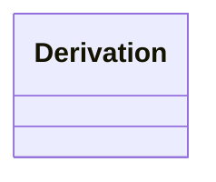

---
search:
  boost: 2.0
---

# Class: Derivation 


_How a value or relation was obtained. Embedded on the record it describes (for example a QuantityValue measured from geometry, or a ConnectionVirtual computed by a contact test) so that every derived fact carries its source kind, method, method version, tolerance, and input entities. Lets checks distinguish values read from IFC, values computed from geometry, project parameters, and manual entries, and lets results be reproduced or recomputed when a method changes._

> **Embedded value type** — nested inside a parent record, not a graph node.

<div data-search-exclude markdown="1">


URI: [pbs:Derivation](https://schema.pragmaticbim.ch/Derivation)





<!-- no inheritance hierarchy -->

## Class Properties

| Property | Value |
| --- | --- |
| Class URI | [pbs:Derivation](https://schema.pragmaticbim.ch/Derivation) |


## Slots

| Name | Cardinality and Range | Description | Inheritance |
| ---  | --- | --- | --- |
| [derivation_source_kind](derivation_source_kind.md) | 1 <br/> [DerivationSourceKind](DerivationSourceKind.md) | Kind of source the value or relation comes from (IFC relationship or property, geometry computation, project parameter, manual entry). | direct |
| [derivation_method](derivation_method.md) | 0..1 <br/> [String](String.md) | Identifier of the method or algorithm that produced the value, for example contact_test, height_above_reference_surface, spacing_along_axis, or the IFC relationship class for ifc_explicit sources. | direct |
| [derivation_method_version](derivation_method_version.md) | 0..1 <br/> [String](String.md) | Version of the method implementation, so results can be reproduced and recomputed when the method changes. | direct |
| [derivation_tolerance](derivation_tolerance.md) | 0..1 <br/> [Double](Double.md) | Geometric or numeric tolerance applied by the method (for example the maximum gap still counted as contact). | direct |
| [derivation_tolerance_unit](derivation_tolerance_unit.md) | 0..1 <br/> [String](String.md) | Unit of derivation_tolerance (for example m, mm, deg). | direct |
| [derivation_inputs](derivation_inputs.md) | * <br/> [Entity](Entity.md) | Entities whose data or geometry were used, beyond the subject itself. For a height measured above a reference surface this includes the reference element (for example the pavement course). | direct |
| [derived_by](derived_by.md) | 0..1 <br/> [SoftwareAgent](SoftwareAgent.md) | Software agent (pipeline, service) that executed the method. | direct |
| [derived_at](derived_at.md) | 0..1 <br/> [Datetime](Datetime.md) | Timestamp when the value or relation was derived. | direct |


## Usages

| used by | used in | type | used |
| ---  | --- | --- | --- |
| [QuantityValue](QuantityValue.md) | [derivation](derivation.md) | range | [Derivation](Derivation.md) |
| [ConnectionVirtual](ConnectionVirtual.md) | [derivation](derivation.md) | range | [Derivation](Derivation.md) |


## Identifier and Mapping Information


### Schema Source


* from schema: https://schema.pragmaticbim.ch


## Mappings

| Mapping Type | Mapped Value |
| ---  | ---  |
| self | pbs:Derivation |
| native | pbs:Derivation |
| exact | prov:Activity |


## LinkML Source

<!-- TODO: investigate https://stackoverflow.com/questions/37606292/how-to-create-tabbed-code-blocks-in-mkdocs-or-sphinx -->

### Direct

<details>
```yaml
name: Derivation
description: How a value or relation was obtained. Embedded on the record it describes
  (for example a QuantityValue measured from geometry, or a ConnectionVirtual computed
  by a contact test) so that every derived fact carries its source kind, method, method
  version, tolerance, and input entities. Lets checks distinguish values read from
  IFC, values computed from geometry, project parameters, and manual entries, and
  lets results be reproduced or recomputed when a method changes.
from_schema: https://schema.pragmaticbim.ch
exact_mappings:
- prov:Activity
slots:
- derivation_source_kind
- derivation_method
- derivation_method_version
- derivation_tolerance
- derivation_tolerance_unit
- derivation_inputs
- derived_by
- derived_at
class_uri: pbs:Derivation

```
</details>

### Induced

<details>
```yaml
name: Derivation
description: How a value or relation was obtained. Embedded on the record it describes
  (for example a QuantityValue measured from geometry, or a ConnectionVirtual computed
  by a contact test) so that every derived fact carries its source kind, method, method
  version, tolerance, and input entities. Lets checks distinguish values read from
  IFC, values computed from geometry, project parameters, and manual entries, and
  lets results be reproduced or recomputed when a method changes.
from_schema: https://schema.pragmaticbim.ch
exact_mappings:
- prov:Activity
attributes:
  derivation_source_kind:
    name: derivation_source_kind
    description: Kind of source the value or relation comes from (IFC relationship
      or property, geometry computation, project parameter, manual entry).
    from_schema: https://schema.pragmaticbim.ch
    rank: 1000
    owner: Derivation
    domain_of:
    - Derivation
    range: DerivationSourceKind
    required: true
  derivation_method:
    name: derivation_method
    description: Identifier of the method or algorithm that produced the value, for
      example contact_test, height_above_reference_surface, spacing_along_axis, or
      the IFC relationship class for ifc_explicit sources.
    from_schema: https://schema.pragmaticbim.ch
    rank: 1000
    owner: Derivation
    domain_of:
    - Derivation
    range: string
  derivation_method_version:
    name: derivation_method_version
    description: Version of the method implementation, so results can be reproduced
      and recomputed when the method changes.
    from_schema: https://schema.pragmaticbim.ch
    rank: 1000
    owner: Derivation
    domain_of:
    - Derivation
    range: string
  derivation_tolerance:
    name: derivation_tolerance
    description: Geometric or numeric tolerance applied by the method (for example
      the maximum gap still counted as contact).
    from_schema: https://schema.pragmaticbim.ch
    rank: 1000
    owner: Derivation
    domain_of:
    - Derivation
    range: double
    minimum_value: 0
  derivation_tolerance_unit:
    name: derivation_tolerance_unit
    description: Unit of derivation_tolerance (for example m, mm, deg).
    from_schema: https://schema.pragmaticbim.ch
    rank: 1000
    owner: Derivation
    domain_of:
    - Derivation
    range: string
  derivation_inputs:
    name: derivation_inputs
    description: Entities whose data or geometry were used, beyond the subject itself.
      For a height measured above a reference surface this includes the reference
      element (for example the pavement course).
    from_schema: https://schema.pragmaticbim.ch
    rank: 1000
    owner: Derivation
    domain_of:
    - Derivation
    range: Entity
    multivalued: true
    inlined: false
  derived_by:
    name: derived_by
    description: Software agent (pipeline, service) that executed the method.
    from_schema: https://schema.pragmaticbim.ch
    rank: 1000
    owner: Derivation
    domain_of:
    - Derivation
    range: SoftwareAgent
    inlined: false
  derived_at:
    name: derived_at
    description: Timestamp when the value or relation was derived.
    from_schema: https://schema.pragmaticbim.ch
    rank: 1000
    owner: Derivation
    domain_of:
    - Derivation
    range: datetime
class_uri: pbs:Derivation

```
</details></div>