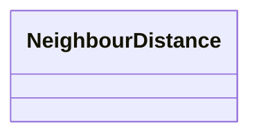

---
search:
  boost: 2.0
---

# Class: NeighbourDistance 


_Clear distance from an element to a neighbouring physical element, measured from geometry: the horizontal gap between their plan outlines and the vertical gap between their height ranges. Both are 0 where the elements overlap in that direction, so 0 and 0 means touching or intersecting._

> **Embedded value type** — nested inside a parent record, not a graph node.

<div data-search-exclude markdown="1">


URI: [pbs:NeighbourDistance](https://schema.pragmaticbim.ch/NeighbourDistance)





<!-- no inheritance hierarchy -->

## Class Properties

| Property | Value |
| --- | --- |
| Class URI | [pbs:NeighbourDistance](https://schema.pragmaticbim.ch/NeighbourDistance) |


## Slots

| Name | Cardinality and Range | Description | Inheritance |
| ---  | --- | --- | --- |
| [neighbour](neighbour.md) | 1 <br/> [PhysicalElement](PhysicalElement.md) | The neighbouring element the distances are measured to. | direct |
| [horizontal_clear_distance](horizontal_clear_distance.md) | 1 <br/> [Double](Double.md) | Horizontal clear distance in metres between the plan outlines; 0 where they overlap or touch. | direct |
| [vertical_clear_distance](vertical_clear_distance.md) | 1 <br/> [Double](Double.md) | Vertical clear distance in metres between the height ranges; 0 where they overlap or touch. | direct |


## Usages

| used by | used in | type | used |
| ---  | --- | --- | --- |
| [PhysicalElement](PhysicalElement.md) | [neighbours](neighbours.md) | range | [NeighbourDistance](NeighbourDistance.md) |
| [Separator](Separator.md) | [neighbours](neighbours.md) | range | [NeighbourDistance](NeighbourDistance.md) |
| [SeparatorWall](SeparatorWall.md) | [neighbours](neighbours.md) | range | [NeighbourDistance](NeighbourDistance.md) |
| [SeparatorSlab](SeparatorSlab.md) | [neighbours](neighbours.md) | range | [NeighbourDistance](NeighbourDistance.md) |
| [ConnectionPhysical](ConnectionPhysical.md) | [neighbours](neighbours.md) | range | [NeighbourDistance](NeighbourDistance.md) |
| [SafetyBarrier](SafetyBarrier.md) | [neighbours](neighbours.md) | range | [NeighbourDistance](NeighbourDistance.md) |
| [Boundary](Boundary.md) | [neighbours](neighbours.md) | range | [NeighbourDistance](NeighbourDistance.md) |
| [Equipment](Equipment.md) | [neighbours](neighbours.md) | range | [NeighbourDistance](NeighbourDistance.md) |


## Identifier and Mapping Information


### Schema Source


* from schema: https://schema.pragmaticbim.ch


## Mappings

| Mapping Type | Mapped Value |
| ---  | ---  |
| self | pbs:NeighbourDistance |
| native | pbs:NeighbourDistance |


## LinkML Source

<!-- TODO: investigate https://stackoverflow.com/questions/37606292/how-to-create-tabbed-code-blocks-in-mkdocs-or-sphinx -->

### Direct

<details>
```yaml
name: NeighbourDistance
description: 'Clear distance from an element to a neighbouring physical element, measured
  from geometry: the horizontal gap between their plan outlines and the vertical gap
  between their height ranges. Both are 0 where the elements overlap in that direction,
  so 0 and 0 means touching or intersecting.'
from_schema: https://schema.pragmaticbim.ch
slots:
- neighbour
- horizontal_clear_distance
- vertical_clear_distance
class_uri: pbs:NeighbourDistance

```
</details>

### Induced

<details>
```yaml
name: NeighbourDistance
description: 'Clear distance from an element to a neighbouring physical element, measured
  from geometry: the horizontal gap between their plan outlines and the vertical gap
  between their height ranges. Both are 0 where the elements overlap in that direction,
  so 0 and 0 means touching or intersecting.'
from_schema: https://schema.pragmaticbim.ch
attributes:
  neighbour:
    name: neighbour
    description: The neighbouring element the distances are measured to.
    from_schema: https://schema.pragmaticbim.ch
    rank: 1000
    owner: NeighbourDistance
    domain_of:
    - NeighbourDistance
    range: PhysicalElement
    required: true
  horizontal_clear_distance:
    name: horizontal_clear_distance
    description: Horizontal clear distance in metres between the plan outlines; 0
      where they overlap or touch.
    from_schema: https://schema.pragmaticbim.ch
    rank: 1000
    owner: NeighbourDistance
    domain_of:
    - NeighbourDistance
    range: double
    required: true
    minimum_value: 0
  vertical_clear_distance:
    name: vertical_clear_distance
    description: Vertical clear distance in metres between the height ranges; 0 where
      they overlap or touch.
    from_schema: https://schema.pragmaticbim.ch
    rank: 1000
    owner: NeighbourDistance
    domain_of:
    - NeighbourDistance
    range: double
    required: true
    minimum_value: 0
class_uri: pbs:NeighbourDistance

```
</details></div>